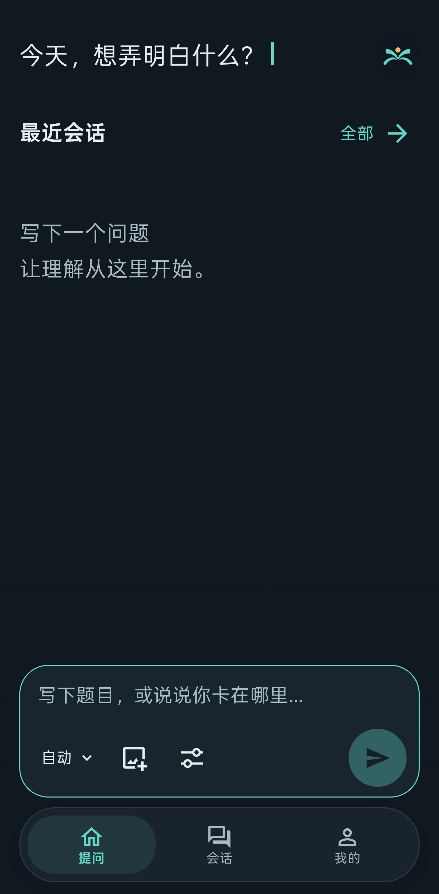
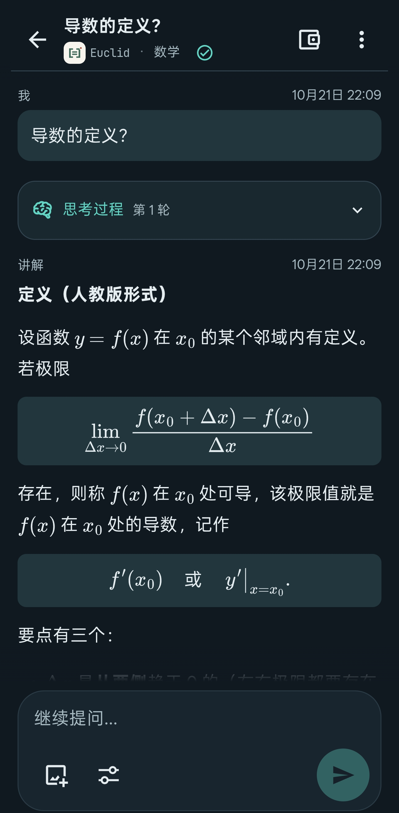
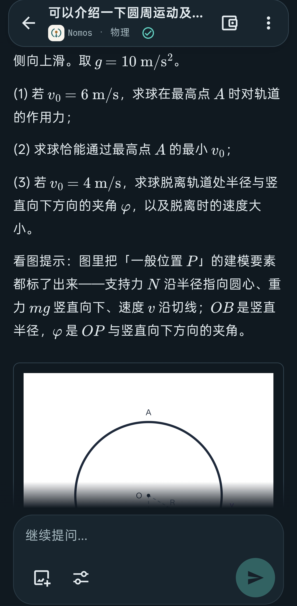

# Synaxis 客户端

一个面向高中学习的多学科 AI 教学客户端。用文字或题图提出问题，阅读包含公式与图示的讲解，在同一会话里追问、答题和回看。

客户端提供学习界面，[Synaxis-backend](https://github.com/STMfan/Synaxis-backend) 负责学科专家、模型调用与教学工具。当前版本为 **1.0.0-hotfix1**，提供 Android、Windows、macOS 和 Linux 原生工程，也可在浏览器中使用。

## 界面预览

| 提问入口 | 数学公式讲解 | 物理图文讲解 |
|:---:|:---:|:---:|
| <a href="docs/images/ask.png"></a> | <a href="docs/images/derivative.png"></a> | <a href="docs/images/circular-motion.png"></a> |

以上为 Android 实际界面，点击图片可查看大图。

## 可以用它做什么

| 学习环节 | 客户端提供的工具 |
|---|---|
| 提出问题 | 输入文字、上传题图，选择学科或交给服务自动判断 |
| 阅读讲解 | 流式阅读正文，查看公式、SVG 图形、图片和分支内容，按需展开思考过程 |
| 继续学习 | 在原会话追问，回答专家提出的问题，保留前后文继续讨论 |
| 回看与整理 | 搜索历史会话，按条件筛选、分页查看、重命名、置顶和归档 |
| 查阅课程标准 | 检索 2017 年版课标，打开章节原文，查看来源文件、PDF 页码和适用课程范围 |
| 管理学习设置 | 调整学习偏好，查看会话预算与费用账本，管理账号和服务连接 |

正文与思考分别展示。网络恢复或应用回到前台后，客户端会同步会话和消息、续接仍在进行的讲解；也可以主动停止当前教学。

界面支持手机竖屏、深浅色主题、减少动态效果、图片放大和原生桌面托盘。原生版本使用系统 WebView。

## 本地使用

需要 Node.js 22.18 或更高版本及 npm。在仓库根目录运行：

```sh
npm ci
npm run dev
```

浏览器打开 `http://127.0.0.1:5173`。客户端默认连接 `http://127.0.0.1:5667`；完整教学功能需要运行后端，并使用管理员创建的学生账号登录。

连接其他服务时，可在「我的 → 服务连接」保存服务根地址，或复制 `.env.example` 为 `.env.local` 并设置：

```dotenv
VITE_API_BASE_URL=https://your-synaxis-server.example
```

构建配置提供新安装的默认地址，应用内保存的地址优先。远程服务使用 HTTPS，浏览器地址需要加入后端的 CORS 配置。

登录后可以选择自动登录，在个人页修改密码、学习偏好或切换服务器。原生端通过系统凭据存储保留刷新凭据；登录与会话恢复的接口说明见 [API 对应说明](docs/api-coverage.md)。

课标检索需要服务端配置本地索引和模型。[Synaxis-Syllabus2017](https://github.com/STMfan/Synaxis-Syllabus2017) 提供数据准备与本地检索工具；课程标准的来源和适用范围随查询结果保留。

## 构建应用

Web 版本使用 `npm run build`，产物位于 `dist/`。原生构建还需要 Rust 1.90 或更高版本及目标平台的 [Tauri 工具链](https://v2.tauri.app/start/prerequisites/)。

| 平台 | 构建命令 | 产物 |
|---|---|---|
| Windows | `npm run build:win` | NSIS 安装包 |
| macOS | `npm run build:mac` | `.app`、`.dmg` |
| Linux | `npm run build:linux` | `.deb` |
| Android | `npm run build:android` | APK |

桌面产物位于 `src-tauri/target/release/bundle/`；Android 的 SDK、Debug 构建与正式签名步骤见 [Android 构建](docs/android.md)。原生开发窗口使用 `npm run dev:desktop`。

## 开发文档

项目使用 **Preact、TypeScript、Tauri 2 和 MathJax**。`src/ui/` 提供学习界面，`src/webview/` 负责 HTTP、鉴权、流式连接与原生交互，`src-tauri/` 提供系统窗口和凭据存储。

- [API 对应说明](docs/api-coverage.md)：客户端功能、后端接口与流式恢复。
- [开发与验证](docs/verification.md)：类型、回归、契约、浏览器检查和源码导出。
- [Android 构建](docs/android.md)：工具链、安装包与签名。
- [字体与图标](docs/typography.md)：系统字体、公式字体及资源来源。
- [更新记录](CHANGELOG.md)：版本变化。

## 许可

自行编写的客户端代码采用 [MIT](LICENSE)。第三方依赖、字体与品牌素材的授权见 [NOTICE](NOTICE) 和 `public/licenses/`；正文默认使用系统字体。
